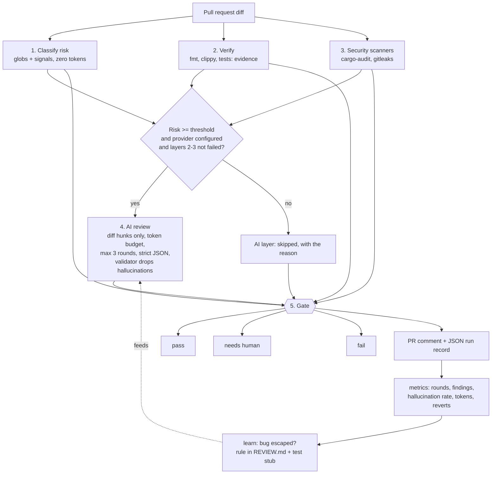

# review-harness

A layered, risk-based code review pipeline for pull requests, as a Rust CLI and a GitHub Action.

The question it asks is not "did a human read this code?" but **"what could go wrong with this
change, and which check, automated or human, is the right one to catch it?"** (the framing from
Anthropic's post on how the Claude Code team does code review).

Its differentiator is cost. Cheap, deterministic layers run first. An LLM reviews a change only when
its risk justifies the spend, under a hard token budget. With **no LLM provider configured the tool
works fully**: the AI layer is skipped with a clear notice. Companies can bring their own key.


## How it works



### Why each layer exists

| Layer | What it answers | Cost | Why it is there |
|---|---|---|---|
| **classify** | How risky is this change? | zero tokens | Decides how much scrutiny to spend. Docs are low, CI files and auth code are high, secrets-like lines force high. |
| **verify** | Is there passing evidence? | CPU only | "Done" without a green run of your own checks is impossible by design: no checks configured means *no evidence*, never a pass. |
| **security** | Known-vulnerable deps? Leaked secrets? | CPU only | Deterministic scanners beat a model at these. A missing scanner is reported as *skipped*, never as passed. |
| **AI review** | What might a careful reviewer flag? | tokens, budgeted | Catches logic bugs scanners cannot. Advisory only: it can request changes, never approve. |
| **gate** | Merge, ask a human, or stop? | zero | One auditable decision table. High risk always needs a human. |
| **metrics / learn** | Is review working? What escaped? | zero | Closes the loop: measure, then turn escaped bugs into rules and tests. |

## Quickstart

```bash
cargo install --path crates/harness-cli      # installs `review-harness`
cd your-repo
review-harness init                           # writes a commented .review-harness.toml
review-harness classify --base origin/main    # risk of this branch
review-harness run --base origin/main         # all layers + gate
echo "exit code: $?"                          # 0 pass, 1 fail, 3 needs human, 2 error
```

### Commands

| Command | Purpose | Exit codes |
|---|---|---|
| `init` | Write the default `.review-harness.toml` | 0 / 2 |
| `classify` | Risk report from `--base/--head` or `--diff-file` (`-` for stdin) | 0 (1 with `--fail-on <level>`) |
| `verify` | Run configured (or `--check name=cmd`) commands, print evidence | 0 verified, 1 failed or no evidence |
| `security` | Run cargo-audit and gitleaks | 0 clean, 1 findings, 3 incomplete |
| `review` | Advisory AI review only | 0, 1 changes requested, 4 failed or over budget |
| `run` | Everything, then the gate | 0 pass, 1 fail, 3 needs human, 2 error |
| `metrics` | Aggregate run records (`--records dir`, optional `--git-limit N`) | 0 |
| `learn` | Record a rule in `REVIEW.md` and scaffold a regression test | 0 / 2 |

`run` accepts `--state-file` (review rounds and tokens persist between pushes), `--record-dir`
(JSON run record), `--comment-file` (the Markdown PR comment) and `--pr-number`.

## GitHub Action

```yaml
# .github/workflows/review-harness.yml  (this repo dogfoods exactly this)
on:
  pull_request:
    types: [opened, synchronize, reopened]
permissions:
  contents: read
  pull-requests: write
jobs:
  review:
    runs-on: ubuntu-latest
    steps:
      - uses: actions/checkout@d23441a48e516b6c34aea4fa41551a30e30af803 # v6.1.0
        with: { fetch-depth: 0, persist-credentials: false }
      - uses: ./            # or Vinisilva0010/review-harness@<full commit sha>
        with:
          base-sha: ${{ github.event.pull_request.base.sha }}
          head-sha: ${{ github.event.pull_request.head.sha }}
          pr-number: ${{ github.event.pull_request.number }}
```

The Action builds the CLI from source, reads `.review-harness.toml` and `REVIEW.md` from the **base**
commit (a PR cannot change its own rules), posts or updates a single PR comment, and writes the report
to the job summary. With no secret configured the comment shows *AI review skipped: no provider
configured*. Required human review is enforced by branch protection:
see [docs/BRANCH_PROTECTION.md](docs/BRANCH_PROTECTION.md).

## Configuration reference (`.review-harness.toml`)

Every key is optional. Unknown keys are rejected.

```toml
[risk]
high   = [".github/workflows/**", "**/action.yml", "**/Dockerfile*", "**/migrations/**",
          "**/*auth*/**", "**/*crypto*/**", "**/*secret*", "**/.env*"]
medium = ["**/*.rs", "**/*.py", "**/*.ts", "**/*.js", "**/*.go", "**/*.java", "**/*.sh"]
low    = ["**/*.md", "docs/**", "**/*.txt", "LICENSE"]
large_file_lines  = 300     # one file changing this much is at least medium
huge_change_lines = 1500    # a PR changing this much is high

[verify]
timeout_secs = 600
checks = [{ name = "test", command = "cargo test --all" }]

[security]
cargo_audit = true
gitleaks    = true
timeout_secs = 300

[review]
provider = "none"           # none | gemini | openai_compatible | anthropic
# model = "..."
# base_url = "https://api.groq.com/openai/v1"   # required for openai_compatible
# api_key_env = "GROQ_API_KEY"                   # the NAME of an env var, never the key
min_risk     = "medium"     # AI review runs at or above this risk
token_budget = 30000        # hard cap on estimated tokens per PR (all rounds)
max_rounds   = 3
```

Path precedence is high, then medium, then low. A file that matches no rule is treated as medium
(unknown is not safe). Signals (CI files, dependency manifests, binaries, large files, secret-like
added lines) can only raise a file's level.

## Cost model

* Layers 1 to 3 and the gate cost no tokens.
* The AI layer is skipped when: no provider is configured, the API key variable is unset, risk is
  below `min_risk`, there is nothing to review, or a deterministic layer already failed.
* When it runs it sends **only the diff hunks of changed files** plus your `REVIEW.md` rules, never
  the repository. Input size is estimated as `bytes / 3` and checked **before** sending against
  `token_budget`, which is cumulative across rounds and includes the JSON retry. Over budget means the
  call is refused and a human is asked; nothing is silently truncated.
* Rounds after the first review only the lines changed since the last reviewed commit, and a PR gets at
  most 3 rounds, after which the tool says to step back and rethink the approach.
* Worst case per PR is bounded: `token_budget` input tokens plus at most `max_rounds x 2` calls of 2048
  output tokens. Real usage reported by the provider replaces the estimate in the accounting.

## Bring your own key

Keys come from environment variables only. Put the variable *name* in the config and the value in your
shell or CI secrets:

```toml
[review]
provider    = "gemini"            # or anthropic, or openai_compatible (Groq, etc.)
model       = "<model id>"
api_key_env = "GEMINI_API_KEY"
```

`.env.example` lists the variable names. The tool never reads `.env` files. See [SECURITY.md](SECURITY.md).

## Development

```bash
cargo fmt --all --check && cargo clippy --all-targets -- -D warnings && cargo test --all
cargo audit
```

No test reaches the external network or a real LLM (a few provider-transport tests talk to a throwaway loopback server on 127.0.0.1): providers are tested with `MockProvider`, a fake HTTP
transport and recorded JSON fixtures (`crates/harness-core/tests/fixtures/`).

More: [ARCHITECTURE.md](ARCHITECTURE.md), [SECURITY.md](SECURITY.md), [DECISIONS.md](DECISIONS.md),
[examples/](examples/), [docs/GUIA-PT.md](docs/GUIA-PT.md) (Portuguese walkthrough),
[docs/PITCH.md](docs/PITCH.md).

## License

MIT
